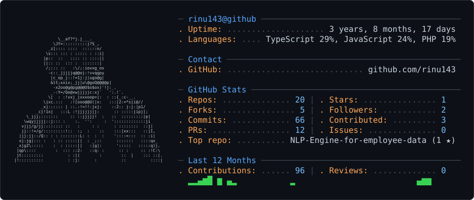

<picture>
  <source media="(prefers-color-scheme: dark)" srcset="dark_mode.svg" />
  <source media="(prefers-color-scheme: light)" srcset="light_mode.svg" />
  
</picture>

Software developer working across systems, machine learning, and full-stack web applications. Most of my work sits around computer vision pipelines, native Windows integrations, and edge-first web backends.

---

## Featured Projects

| Project | Description | Core Stack |
| :--- | :--- | :--- |
| **[Peek](https://github.com/rinu143/peek)** | Windows biometric face-unlock using deep ArcFace embeddings and independent dual-gate liveness checks. Integrates with Windows Media Foundation and Credential Provider boundaries. | `Python` `OpenCV` `ArcFace` `Win32` |
| **[Trashey](https://github.com/rinu143/trashey)** | Image-based 6-class recyclable waste classifier built using hand-engineered vision features and a tuned Random Forest (73.9% test accuracy vs 16.7% baseline). | `Python` `Scikit-learn` `OpenCV` |
| **[Chali](https://github.com/rinu143/chali)** | Edge-native Malayalam joke sharing app. Uses cursor-based random walks on indexed Cloudflare D1 (SQLite) behind Cloudflare Workers for sub-millisecond lookups. | `JavaScript` `Cloudflare Workers` `D1` `Vite` |
| **[ZeroSight](https://github.com/rinu143/ZeroSight)** | Privacy-first campus lost-and-found platform with multimodal visual feature extraction using vision language models (Nemotron VLM). | `Node.js` `Express` `MongoDB` `Vision AI` |
| **[Googlle](https://github.com/rinu143/googlle)** | Real-time mentalism performance tool disguised as a search engine that streams spectator inputs live to a performer's private dashboard. | `React` `Node.js` `WebSockets` `Razorpay` |
| **[Forge AI](https://github.com/rinu143/forge.ai)** | Startup advisory co-pilot that analyzes problems and crafts execution roadmaps tailored to runway, tech stack, and team constraints. | `TypeScript` `React` `Tailwind CSS` `Vite` |

---

## Tech Stack

  
  
  
  
  
  
  
  
  
  
  
  
  

- **Languages:** TypeScript, JavaScript, Python, PHP, SQL
- **Backend & Cloud:** Node.js, Express, Cloudflare Workers, Cloudflare D1, MongoDB, REST APIs, WebSockets
- **Frontend:** React, Vite, Tailwind CSS, HTML5, CSS3
- **Vision & ML:** OpenCV, ArcFace, Scikit-learn, Feature Engineering

---

## GitHub Activity

  
  

---

## Get in Touch

- Email: [rinumanoj402@gmail.com](mailto:rinumanoj402@gmail.com)
- Instagram: [@rinu.exe](https://www.instagram.com/rinu.exe/)
- GitHub: [@rinu143](https://github.com/rinu143)
